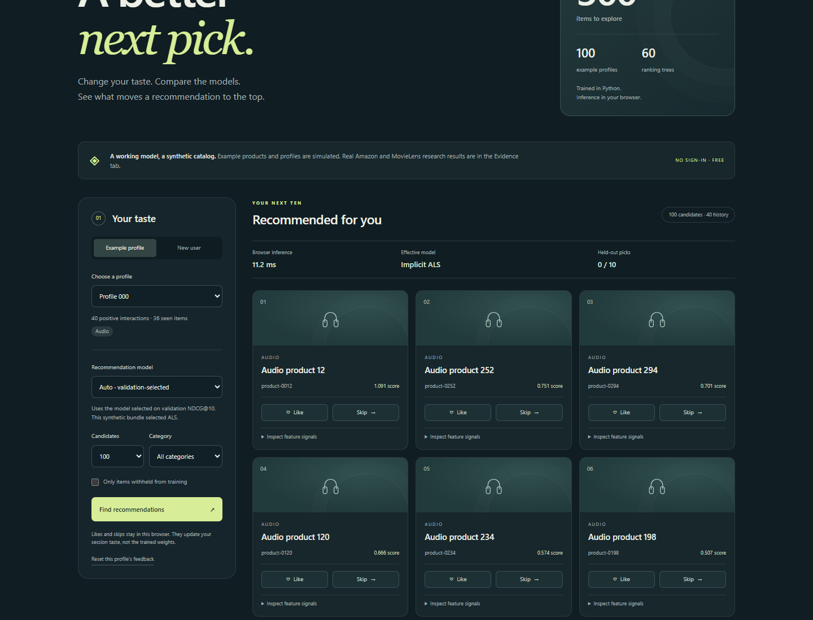
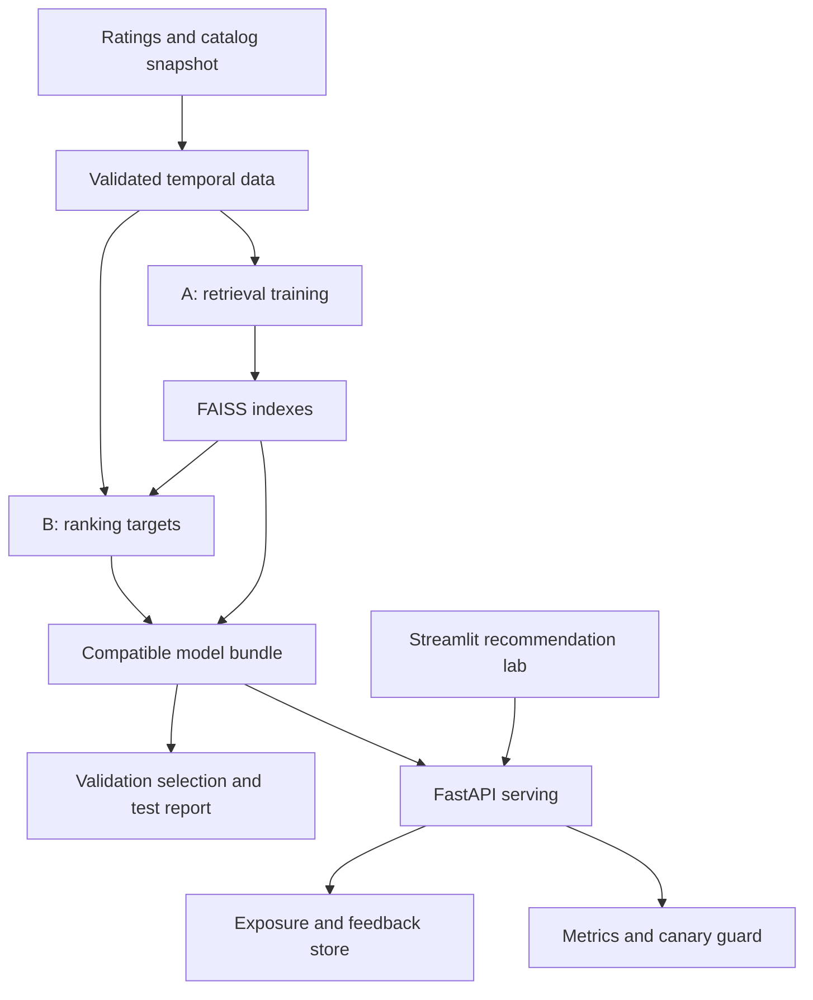

# Atlas — Cold-Start Recommendation Under a Strict Latency Budget

[](https://github.com/Jill-Vekariya/atlas-recsys/actions/workflows/ci.yml)

Atlas is an end-to-end recommendation engineering project: PyTorch retrieval, FAISS indexing,
LightGBM ranking, full-catalog temporal evaluation, FastAPI serving, a Streamlit lab, feedback
logging, and verified model rollout/rollback.

The experiment asks how item content affects recommendations for products without training
interactions, and what serving cost that improvement introduces. It keeps failed experiments
and strong baselines visible. This repository does not establish production-scale performance
or business uplift.

## Start here

Read [measured results](docs/RESULTS.md), [the interview guide](docs/INTERVIEW_GUIDE.md),
[deployment instructions](docs/DEPLOYMENT.md), and [ownership exercises](docs/OWNERSHIP.md).

**[Open the live recommendation lab](https://jill-vekariya.github.io/atlas-recsys/)** ·
[Source](https://github.com/Jill-Vekariya/atlas-recsys) · [Docker image](https://github.com/users/Jill-Vekariya/packages/container/package/atlas-recsys)

[](https://jill-vekariya.github.io/atlas-recsys/)

The GitHub Pages demo runs exported trained models directly in your browser. It needs no
sign-in, API key, running PC, card, or backend. Compare seven modes, try new-user preferences,
inspect ranking signals, and explore the real-data evidence. The interactive catalog is
synthetic; likes and skips stay in your browser. [How browser inference works](docs/GITHUB_PAGES.md).

The full Python/Docker platform includes FastAPI, FAISS, persistent feedback, monitoring, and
rollback. These server features run when you launch Docker; GitHub Pages hosts the browser lab.

The included numeric reports cover **real Amazon Reviews 2023 and MovieLens data**, plus a
separately labeled synthetic fixture. The release includes a small synthetic demo bundle.
Raw research datasets and real-data model bundles are not redistributed in the release.

## Quick start: Python

Install Python 3.12 and uv, then run from this directory:

```bash
uv sync --frozen --extra dev
uv run atlas smoke --config configs/smoke.yaml
uv run atlas activate --bundle artifacts/synthetic-v1
uv run atlas serve
```

In a second terminal:

```bash
uv run streamlit run src/atlas/ui.py --browser.gatherUsageStats=false
```

Open http://127.0.0.1:8501 for the lab and http://127.0.0.1:8000/docs for the API.

The smoke command creates the synthetic bundle omitted from Git. Run it once on a fresh clone.

Existing bundles are immutable. To rerun a model experiment, copy a config and change its
`bundle_dir` and `report_dir` rather than overwriting a completed bundle.

## Quick start: Docker

```bash
docker compose up --build -d
docker compose logs bootstrap
```

The bootstrap service creates a synthetic bundle in persistent volumes. The API starts after
initialization and the demo starts after the API is healthy. Repeated starts reuse the bundle.
Local ports bind to loopback. See the deployment guide for a domain, TLS, and persistent storage.

For a single-container public-demo host, the Dockerfile's default `cloud` target includes the
synthetic model and runs the API, Streamlit, and Caddy on one public port:

```bash
docker build --target cloud -t atlas:cloud .
docker run --rm -p 127.0.0.1:10000:10000 -e ATLAS_EPHEMERAL=true atlas:cloud
```

Open http://127.0.0.1:10000 for the lab and http://127.0.0.1:10000/api/docs for API documentation.
Local Compose uses separate ports; the single-container image uses the one mapped port.
The configured Windows PC maps that port to **10080** instead.

| Launch mode | Lab | API documentation |
|---|---|---|
| Public browser demo | https://jill-vekariya.github.io/atlas-recsys/ | Browser inference; no hosted Python API |
| Python or local Compose | http://127.0.0.1:8501 | http://127.0.0.1:8000/docs |
| Docker command above | http://127.0.0.1:10000 | http://127.0.0.1:10000/api/docs |
| Configured Windows PC | http://localhost:10080 | http://localhost:10080/api/docs |

`localhost` and `127.0.0.1` always refer to the computer opening the link. They cannot be used
as public resume links. Use the GitHub Pages address for sharing. The older Cloudflare tunnel
is optional and temporary; see [the no-card guide](docs/FREE_DEMO.md).

**Verification:** 26 Python tests pass locally. Browser inference has five numerical/protocol
tests and four real-browser interaction tests. The Pages deployment passed its independent
browser checks. Docker/auth/feedback/WebSocket checks and real-data experiments are recorded
in [the verification record](docs/VERIFICATION.md). Check the Actions badges for the latest commit.

[Published Docker image](https://github.com/users/Jill-Vekariya/packages/container/package/atlas-recsys):

```bash
docker pull ghcr.io/jill-vekariya/atlas-recsys:latest
docker run --rm -p 127.0.0.1:10000:10000 -e ATLAS_EPHEMERAL=true ghcr.io/jill-vekariya/atlas-recsys:latest
```

Anonymous registry access and the published digest were verified. For a reproducible deployment,
pin the digest in [the image manifest](reports/deployment/image-manifest.json).

[No-card public demonstration guide](docs/FREE_DEMO.md). Render creation was blocked by an
account payment-information requirement, and that provider was not used.

## Data and experiments

```bash
# Real Amazon catalog sampled independently of review labels.
uv run atlas prepare --config configs/amazon.yaml
uv run atlas train --config configs/amazon.yaml
uv run atlas evaluate --config configs/amazon.yaml --split test

# A second real-data workload with richer user histories.
uv run atlas prepare --config configs/movielens.yaml
uv run atlas train --config configs/movielens.yaml
uv run atlas evaluate --config configs/movielens.yaml --split test

# Item representation ablations use validation only.
uv run atlas ablations --config configs/movielens.yaml
uv run atlas tradeoffs --config configs/movielens.yaml
```

These commands download public research data. MovieLens has research-use conditions; inspect
its downloaded README. Review ratings are preference proxies, not purchases or impressions.

## Evaluation protocol

Four **global chronological windows** separate retrieval training, ranker training, validation,
and final test. Equal-time interactions do not enter earlier histories. A deterministic item
cohort has all events withheld from both training windows. Catalog text transforms are fit on
the supplied catalog snapshot, an explicitly transductive assumption.

The ranker uses candidates from a frozen earlier retriever, with no artificial injection of
ground-truth items. Queries with no informative labels are counted and excluded from ranker
training; they remain in end-to-end evaluation.

Evaluation uses the fixed eligible catalog, excludes all products previously rated before the
prediction cutoff, macro-averages users, reports cold/new/returning cohorts, and bootstraps paired
user differences. Model selection uses validation NDCG@10 only. Test results never select the
serving default. A validation-selected model can lose on test, and this happened in the recorded
MovieLens run.

## What distinguishes this implementation

- Controlled item cold-start experiments with leakage checks.
- Separate relevance recall and approximate-index recall.
- A shared evaluation/serving feature implementation.
- A recommendation feature inspector with explicitly non-causal diagnostics.
- Training/export parity checks between PyTorch and NumPy inference.
- Content-only and identity-only item-tower ablations.
- Open-loop HTTP benchmarks that include dispatch delay and queueing.
- Idempotent feedback, separate exposure logs, and exclusion of load-test feedback.
- Compatible model/index/feature bundles with asset checksums.
- Deterministic canary assignment and a regression-triggered rollback demonstration.
- Measured failures and decision records rather than unsupported improvement claims.

## Verification

```bash
uv run pytest -q
uv run ruff check src tests scripts
uv run ruff format --check src tests scripts
uv run atlas verify-local --rate 50 --duration 10 --check-ui
uv run atlas canary-demo
```

For an already running server:

```bash
uv run atlas load-test --url http://127.0.0.1:8000 --rate 50 --duration 30
```

The local verifier starts a real HTTP server, runs the client workload, optionally exercises
Streamlit user/feedback flows, and then shuts down that server. This is a local benchmark,
not an external hosting service.

## Lifecycle commands

```bash
uv run atlas inspect --bundle artifacts/synthetic-v1
uv run atlas activate --bundle artifacts/synthetic-v1
uv run atlas activate --bundle artifacts/a-new-version --canary-percent 5
uv run atlas rollback
uv run atlas export-feedback --output data/feedback/staged.jsonl
```

Feedback export is a staging dataset with source and model version retained. It does not
automatically retrain a model or turn clicks into purchase labels. See the data card and runbook.

## Publishing

Use `scripts/publish_github.sh` for a new fork after authenticating GitHub CLI and configuring your own Git
author identity. It defaults to a private repository. Set `ATLAS_VISIBILITY=public` to deliberately
publish publicly. CI checks Python behavior and a Docker Compose startup. The Pages workflow checks numerical parity
and browser interactions before publishing the lab. A separate workflow
publishes the container to GHCR when manually invoked or when a version tag is pushed.

## Architecture



## Practical limits

This is a single-host engineering portfolio. There is no distributed training, online business
A/B result, automatic feedback retraining, learned sequential model, or continuously updated
catalog. Histories refresh when a new bundle is built. The 150 ms deadline detects a slow result
after completion; it cannot interrupt a native FAISS operation. Asset checksums detect corruption,
not malicious artifacts. Load only bundles built by a trusted operator.

See [the data card](docs/DATA_CARD.md), [model card](docs/MODEL_CARD.md), and
[decision records](docs/decisions/001-evaluation.md) for scope and assumptions.
