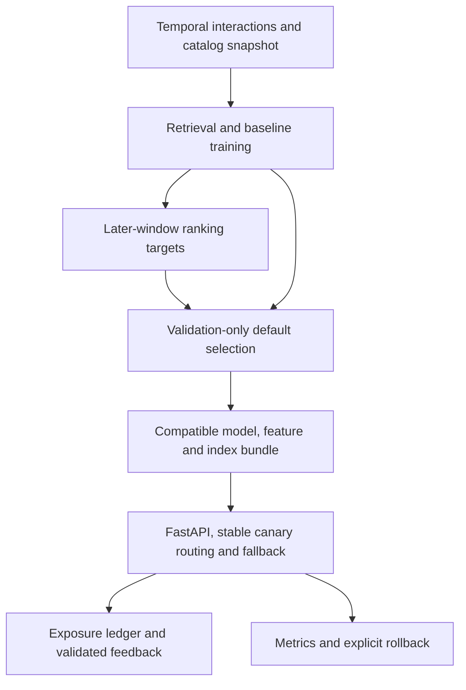

# Atlas

**Cold-start recommendation experiments connected to versioned serving and rollback.**

Atlas compares popularity/content/collaborative baselines with PyTorch retrieval, FAISS indexing and optional LightGBM ranking. Chronological evaluation selects the default using validation only. FastAPI serves compatible bundles with fallback, stable canary assignment, exposure logging and validated feedback.

[Browser lab](https://jill-vekariya.github.io/atlas-recsys/) · [Recorded results](docs/RESULTS.md) · [Model-selection failure case](docs/MODEL_SELECTION_CASE_STUDY.md) · [Interview guide](docs/INTERVIEW.md)

The browser lab runs exported models over a synthetic catalog; likes/skips stay in the browser. FastAPI, FAISS, persistent feedback and rollout controls belong to the separate Python/Docker application. [Browser architecture](docs/GITHUB_PAGES.md).

## Architecture



Retrieval uses window A; ranking uses frozen A retrieval/histories with later B targets. Validation and test are separate later windows. Controlled cold items lack training interactions but retain catalog snapshot metadata; this does not reconstruct real launch dates. [Evaluation decision](docs/decisions/001-evaluation.md) · [Serving decision](docs/decisions/002-serving.md).

## Quick start: Python API

Requires Git, Python 3.12, uv and dependency-download access. On a fresh checkout:

```bash
git clone https://github.com/Jill-Vekariya/atlas-recsys.git
cd atlas-recsys
uv sync --frozen --extra dev
uv run --no-sync atlas smoke --config configs/smoke.yaml
uv run --no-sync atlas serve
```

Open `http://127.0.0.1:8000/docs`. Smoke prepares synthetic data, trains/evaluates a bundle and activates it; a second activation command is unnecessary. The optional Streamlit lab is `uv run --no-sync streamlit run src/atlas/ui.py --browser.gatherUsageStats=false`, at `http://127.0.0.1:8501`.

Completed bundles/reports are retained. For another experiment, copy the config and select unused `dataset_dir`, `bundle_dir`, `report_dir` and routing `--state` paths. Fresh smoke reports live under `artifacts/reports/synthetic-v1/`; tracked `reports/` measurements are historical. Do not delete old evidence to make a repeated command pass.

For Docker Linux/Compose v2, `docker compose up --build -d` bootstraps the synthetic model in persistent volumes before starting API and lab. Stop with `docker compose down`, preserving volumes. [Deployment guide](docs/DEPLOYMENT.md) · [Local Docker](docs/LOCAL_DOCKER.md). A public browser lab is not a hosted Python API; the earlier Render backend attempt was blocked by a payment-information requirement.

## Evidence and verification

| Evidence | Recorded result | Interpretation |
| --- | --- | --- |
| [MovieLens case study](docs/MODEL_SELECTION_CASE_STUDY.md) | Validation-selected model lost to popularity on final test | Retained generalization failure; no invented uplift |
| [Amazon/MovieLens reports](docs/RESULTS.md) | Real-data offline comparisons with explicit cohort sizes and one seed | Ratings are preference proxies; catalog snapshot and cohort assumptions apply |
| [Windows load diagnostic](docs/FINAL_ENGINEERING_VERIFICATION.md) | Synthetic 5 RPS diagnostic met the target; 50 RPS missed it | Host/workload-specific observations, not a latency SLA |
| [Stage 4 local review](docs/INTERVIEW.md) | 24 selected tests passed | Synthetic temporary serving, fallback, feedback, rollout and retention fixtures |

From the installed checkout:

```bash
uv run --no-sync pytest -q
uv run --no-sync ruff check src tests scripts
uv run --no-sync ruff format --check src tests scripts
uv run --no-sync python scripts/model_selection_audit.py --report-dir reports/movielens
python scripts/check_links.py
```

The audit replays recorded model selection without retraining. New canary/load experiments need fresh output paths and the workload limits in [the runbook](docs/RUNBOOK.md); a synthetic injected-error rollback demonstrates routing mechanics, not measured online recommendation quality. The [image manifest](reports/deployment/image-manifest.json) identifies historical image evidence; a mutable `latest` tag is not a reproducible source identity.

## Serving contract and limits

- Bundle activation checks assets, dimensions, item mappings and feature order before changing routing. Load only trusted operator-built artifacts; checksums detect inconsistency, not authenticity.
- Seen items are excluded. Retrieval exceptions fall back to popularity with an explicit reason. The 150 ms elapsed check happens after retrieval returns and cannot interrupt a native FAISS call.
- Histories are bundle snapshots. Feedback validates exposed items and event identity, rejects load-test traffic and exports separately; it does not immediately retrain/personalize the next request.
- Production mode requires `ATLAS_ENV=production` and a private `ATLAS_API_KEY` of at least 24 characters before startup. Actual request-body bytes are capped at 65,536 before JSON parsing. Local mode/Compose bind to loopback; public deployment needs separate TLS, resource and persistence review.

Single-host state, static catalog/histories, coarse process-local limits and limited offline cohorts remain explicit. No production scale, business A/B gain or fresh public backend availability is established. [Data card](docs/DATA_CARD.md) · [Model card](docs/MODEL_CARD.md).

## Ownership, next work and license

Implementation, experiments and documentation used AI assistance. [OWNERSHIP.md](docs/OWNERSHIP.md) keeps personal coding/reproduction exercises pending until actual evidence is added. Next: rolling as-of histories, reviewed feedback import and a new untouched temporal evaluation period, before infrastructure expansion without a measured need.

Existing [LICENSE](LICENSE) and [data-rights notice](NOTICE.md) are preserved. Licensing/attribution decisions remain subject to owner review; this presentation update selects no new license and grants no external dataset rights.

## Temporal seed study

The [Stage 4 temporal study](docs/STAGE4_TEMPORAL_STUDY.md) fixes temporal data and evaluation users across seeds, seals validation-only selections before final evaluation, and preserves missing cohorts and unfavorable model comparisons.
