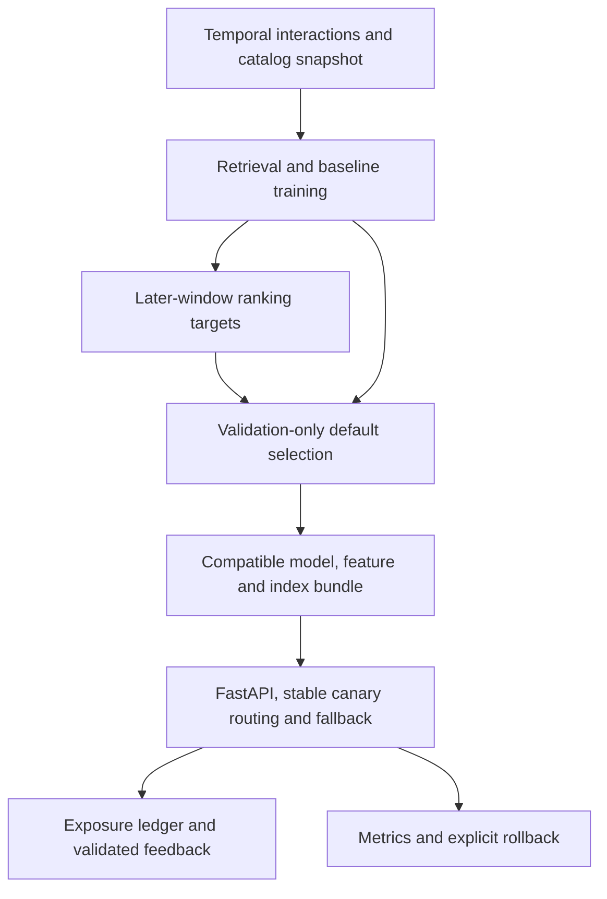

# Atlas — cold-start recommendations, from offline experiment to versioned serving

[](https://github.com/Jill-Vekariya/atlas-recsys/actions/workflows/ci.yml)

[](LICENSE)

**[Try the browser lab](https://jill-vekariya.github.io/atlas-recsys/)** · [Model-selection case study](docs/MODEL_SELECTION_CASE_STUDY.md) · [Recorded results](docs/RESULTS.md) · [Runbook](docs/RUNBOOK.md)

## The problem

New catalogue items have little or no interaction history, and random train/test splits can overstate recommendation quality by leaking future information. Atlas compares content and collaborative approaches on chronological splits, then serves versioned model bundles with canary routing, fallback and rollback.

## My involvement

I have invested sustained personal effort in this project and reviewed it repeatedly throughout development. My focus is cold-start recommendations, temporal evaluation, model selection and versioned serving with fallback and rollback. See [project ownership and review](docs/OWNER_REVIEW.md) for my current statement, review scope and technical references.

## Implementation

- **Four approaches compared on the same chronological split:** popularity, item-based collaborative filtering, a content baseline, and a PyTorch two-tower retriever with FAISS nearest-neighbour search and an optional LightGBM re-ranker.
- **Time-respecting evaluation:** retrieval trains on window A, ranking targets come from a later window B, and validation and test are separate later windows. Cold items are held out of training but keep their catalogue metadata.
- **A serving layer in FastAPI:** model/index bundles are validated before activation, traffic can be canaried between bundles, retrieval failures fall back to popularity with an explicit reason, and rollback is a single command.
- **An exposure and feedback ledger:** every recommendation is logged with its bundle version so that later feedback can be joined back to what the user actually saw.
- **A browser lab** that runs exported models on a synthetic catalogue entirely client-side, so anyone can try it without a backend.

## Results

| Experiment | Result | What it tells you |
| --- | --- | --- |
| MovieLens, validation-selected two-tower | **0.2340 test NDCG@10** | Model selected by the validation-only rule |
| MovieLens, popularity baseline | **0.2598 test NDCG@10** | The baseline beat it on the final test |
| [Multi-seed temporal study](docs/STAGE4_TEMPORAL_STUDY.md) | Selection sealed before test; failed seeds retained | Guards against picking the lucky seed |
| Load diagnostic (local, synthetic) | 5 RPS met target, 50 RPS missed | Single-host numbers, not an SLA |

The recorded test result favoured the simpler baseline. The [case study](docs/MODEL_SELECTION_CASE_STUDY.md) walks through why validation-only selection picked a model that lost to popularity, and what the cold-start cohort looked like underneath that average. Single seed, offline, preference ratings as proxies: see [RESULTS.md](docs/RESULTS.md) for every caveat.

## Where this applies

- **E-commerce and marketplaces:** new listings need impressions before they have signals. The cold-item cohort metrics are the ones a merchandising team actually cares about.
- **Media and ed-tech:** new releases and new courses have the same problem, and the chronological split mirrors how those systems are evaluated in practice.
- **Any ML platform team:** bundle validation, canary routing, fallback and rollback are the parts that turn a notebook into something you can put behind an API.

## Architecture



Design notes: [evaluation decision](docs/decisions/001-evaluation.md) · [serving decision](docs/decisions/002-serving.md) · [browser-lab architecture](docs/GITHUB_PAGES.md).

## Quick start

Requires Python 3.12 and [uv](https://docs.astral.sh/uv/).

```bash
git clone https://github.com/Jill-Vekariya/atlas-recsys.git
cd atlas-recsys
uv sync --frozen --extra dev
uv run --no-sync atlas smoke --config configs/smoke.yaml   # synthetic data, train, evaluate, activate
uv run --no-sync atlas serve                               # http://127.0.0.1:8000/docs
```

Optional Streamlit lab: `uv run --no-sync streamlit run src/atlas/ui.py` (port 8501). Docker: `docker compose up --build -d`. Tests and lint: `uv run --no-sync pytest -q` and `uv run --no-sync ruff check src tests scripts`. Full operator detail is in the [reference guide](docs/REFERENCE.md), [deployment guide](docs/DEPLOYMENT.md) and [runbook](docs/RUNBOOK.md).

## Engineering takeaways

- A good validation score is not a shipping decision. Seal the selection, then look at the test set once.
- Average NDCG hides the cold-start cohort. Report the cohort you built the system for.
- Fallback with a logged reason is worth more than a slightly better model with no fallback.

## Limits

- Single-host state, static catalogue snapshot, one offline seed on real data. No online A/B result.
- Bundle checksums detect inconsistency, not tampering; load only artifacts you built.
- The 150 ms budget check runs after retrieval returns; it cannot interrupt a native FAISS call.
- Production mode requires `ATLAS_ENV=production` and a private API key; the public browser lab is not a hosted API.

[Data card](docs/DATA_CARD.md) · [Model card](docs/MODEL_CARD.md) · [Full reference](docs/REFERENCE.md)


## License

See [LICENSE](LICENSE) and the [data-rights notice](NOTICE.md). Datasets keep their original terms.
