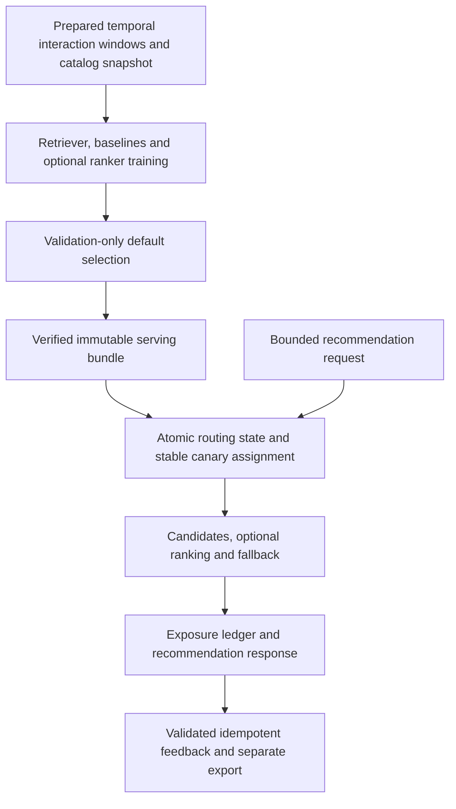

# Atlas — technical interview guide

Stage 4 review: 27 October 2026. This guide describes the repository; personal authorship requires the separate confirmation below.

## Evidence boundary

| Item | Status and scope |
| --- | --- |
| Reviewed implementation | **VERIFIED by inspection:** base `f5816cb519ca5e09f55d7d271f13f91218db9af4` plus existing uncommitted Stage 1 request-boundary/report-retention changes. `git status --short` and `git diff HEAD` identify the local delta. |
| Fresh interview checks | **VERIFIED locally:** 24 selected serving, bundle validation, fallback, feedback concurrency, rollout, request-boundary and evidence-retention tests passed with synthetic temporary fixtures. This is a focused subset, not the complete suite. Commands below. |
| Recorded experiments | [Results](RESULTS.md) and [model-selection case study](MODEL_SELECTION_CASE_STUDY.md) retain dataset/cohort/seed-specific observations. They do not establish business uplift. Stage 1 separately reproduced a fresh synthetic train/serve/canary workflow. |
| Deployment | The browser demonstration is distinct from the Python service. A new public backend is **UNVERIFIED**; a fresh Docker build is **BLOCKED** by the absence of Docker on this host. [Current status](CURRENT_STATUS.md) identifies the browser/backend distinction. Do not infer deployment from a Dockerfile. |

## 60-second pitch

Atlas is a recommendation engineering lab that connects offline model selection with a versioned serving path. It compares popularity, collaborative and content baselines with a PyTorch retrieval model and optional LightGBM ranking. Training uses chronological windows and validation-only default selection. Serving loads a bundle containing item mappings, arrays, indexes and feature metadata, then checks compatibility before activation. Requests use stable user-based canary routing, exclude seen items and record exposures for validated feedback. Retrieval failure falls back to popularity, and routing can roll back without retraining. The important lesson is that extra model complexity is conditional: a ranker cannot retrieve missing positives, and a baseline can win. Offline relevance, ANN approximation, synthetic reliability checks and production outcomes are reported as different evidence.

## Three-minute walkthrough

**0:00–0:45 — Evaluation before complexity.** Open [pipeline.py](../src/atlas/pipeline.py) · `train`. Retrieval learns in window A; ranking uses a frozen A retriever and A histories with later B targets. Validation selects the default by macro NDCG@10; final test results do not select it. Explain why the controlled cold-item split withholds interactions while leaving snapshot metadata available: it is not a reconstruction of real historical item launch dates.

**0:45–1:25 — Retrieval and ranking.** Follow [Bundle.candidates](../src/atlas/bundle.py). A content/history projection forms a query vector. Normalized item vectors are searched with FAISS; exact search is a reference for HNSW approximation. Optional ranking reorders retrieved candidates using the declared feature schema. Explain why ANN neighbor recall and relevant-item recall answer different questions, and why no ranker can recover an item absent from the candidate set. The selected default can be a simpler algorithm.

**1:25–2:15 — One serving request.** In [api.py](../src/atlas/api.py), show request bounds, optional local authentication and the mandatory production-key guard. `Registry.select` reloads routing state and deterministically assigns a user. Static bundle histories supply seen/positive items; preferences can seed a new user. The response states requested/effective algorithm and fallback reason. `Store.exposure` persists the shown items; feedback must reference an actual exposure and cannot turn load-test traffic into training evidence.

**2:15–3:00 — Reliability and honest limits.** Demonstrate an injected retrieval exception in a test and a live routing-state rollback in `test_canary_assignment_and_live_rollback`; both are local fixtures. A 150 ms elapsed check occurs after retrieval, so it cannot interrupt FAISS while it runs. SQLite is local state, history is static and the canary exercise does not measure online recommendation quality. Finish by showing an existing result where added ranking complexity did not win, then propose rolling-time evaluation on a new period instead of tuning against the consumed test.

## Architecture



Feedback export is not automatic online retraining. The request path uses exported NumPy representations and FAISS, without requiring a live PyTorch inference server or remote MLflow service.

## One end-to-end execution trace

Trace `POST /recommend` for an unknown user, then retry with onboarding preferences:

| Step | Path and symbol | Observable behavior |
| --- | --- | --- |
| 1 | [api.py](../src/atlas/api.py) · `RecommendRequest`, `create_app` | Validate user/category lengths, `k` 1–50 and candidate count 50–1000; [middleware.py](../src/atlas/middleware.py) · `BodyLimitMiddleware` caps actual received body bytes before JSON parsing. |
| 2 | [registry.py](../src/atlas/registry.py) · `Registry.select`, `bucket` | Read routing state; hash the user into the primary/canary slot. A chosen bundle is returned with its slot. |
| 3 | [api.py](../src/atlas/api.py) · `create_app.recommend` | Read static bundle histories. Known preference categories can seed history for a cold user; unknown categories increment diagnostics. |
| 4 | [bundle.py](../src/atlas/bundle.py) · `Bundle.candidates` | Exclude seen items. No positive history normally triggers popularity fallback. Category-constrained vector retrieval uses exact eligible-item scoring to avoid post-filter starvation. |
| 5 | [api.py](../src/atlas/api.py) · `create_app.recommend` | Retrieval exception or detected elapsed deadline falls back to popularity; response retains the fallback reason and effective algorithm. |
| 6 | [storage.py](../src/atlas/storage.py) · `Store.exposure` | Save request/user/source/model/slot and recommended item IDs before returning the response. This is an exposure record, not a user preference. |
| 7 | [api.py](../src/atlas/api.py) · `create_app.feedback`; [storage.py](../src/atlas/storage.py) · `Store.feedback` | A subsequent `POST /feedback` validates the exposure/item relationship and event idempotency; conflicts return 409. |

The regression entry points are [test_unknown_user_fallback and onboarding tests](../tests/test_serving.py). Tests train their own small temporary synthetic bundle rather than relying on mutable retained reports.

## Decisions and alternatives

| Implemented decision | Cost or risk | Evidence that could justify an alternative |
| --- | --- | --- |
| Four chronological windows; [evaluation decision](decisions/001-evaluation.md) | Few returning users in some cohorts; later catalog snapshot assumption. | Rolling prediction snapshots, more returning users and a new untouched evaluation period. |
| Train in PyTorch, serve exported arrays; [serving decision](decisions/002-serving.md) | Export compatibility/parity must remain tested; not a general deep inference stack. | A validated architecture needing richer per-request computation or measured export drift. |
| Exact FAISS reference and HNSW option; [bundle.py](../src/atlas/bundle.py) | Approximation trades recall for speed; strong index recall cannot repair poor embeddings. | Measure neighbor recall, relevant recall, latency and memory on the actual larger catalog. |
| Validation chooses among baselines and complex models; [pipeline.py](../src/atlas/pipeline.py) | Selection over a small window can overfit; ranker groups without positives are excluded from training. | More representative validation, a prespecified selection rule and new held-out results. |
| Atomic local state file and SQLite feedback; [registry.py](../src/atlas/registry.py), [storage.py](../src/atlas/storage.py) | Single-host operational scope; no coordinated multi-host rollout. | Availability/concurrency requirements that justify a shared registry and transactional store. |
| Refuse occupied report directories; [reports.py](../src/atlas/reports.py) | Repeated experiments need new named paths. | An explicit versioned experiment store; silent overwriting is not an acceptable shortcut. |

## Challenging questions and accurate answers

**How do you avoid training a ranker on retrieval leakage?** Freeze the retriever and A-window histories before constructing B-target candidate groups. Do not inject missing positive items to make ranking artificially easy. Validation and final test remain later windows. See `train` and its recorded training protocol in [pipeline.py](../src/atlas/pipeline.py).

**Is a cold item truly newly launched?** No. A seeded hash withholds interactions in both training windows; catalog text remains available under a snapshot assumption. That tests missing interaction history with available content, not historical launch timing. The assumption is explicit in [Decision 001](decisions/001-evaluation.md).

**What does a better ANN recall mean?** It means approximate retrieval matches exact neighbors under the same learned representation. It does not establish that those neighbors are relevant. [evaluation.py](../src/atlas/evaluation.py) keeps relevance evaluation separate from ANN trade-offs.

**Is the deadline a latency guarantee?** No. The API checks elapsed time after a retrieval call returns. It may issue a fallback after already exceeding 150 ms; it cannot preempt native code, undo waiting time or promise a service percentile. See the explicit comment in [api.py](../src/atlas/api.py).

**Does feedback immediately personalize the next request?** No. The serving histories come from the bundle snapshot. Feedback is validated, stored and separately exportable. Import semantics, label/source separation and as-of histories require further design before online personalization.

**Why can ranker performance be worse?** It only reranks candidates; uninformative candidate groups are excluded, and ranking features may emphasize patterns that do not generalize. These are mechanisms to investigate, not established causes for every observed result. [RESULTS.md](RESULTS.md) and [the case study](MODEL_SELECTION_CASE_STUDY.md) show the actual selection and cohort limitations.

**Does checksum validation make model loading safe for hostile uploads?** No. Bundle checks detect inconsistent assets/schema under trusted-operator assumptions. A coordinated replacement of artifacts and their checksum manifest is not authenticated by self-contained hashes. Do not accept untrusted model bundles.

**Does a canary test show a successful A/B experiment?** No. Stable assignment and rollback can be verified with local synthetic traffic. A quality experiment additionally needs an outcome definition, exposure/assignment analysis, adequate sample and an unbiased time window. The existing injected-failure demo is an operational fixture.

## Supported failure and debugging examples

| Case | Established behavior | Hypothesis or further investigation |
| --- | --- | --- |
| Retrieval failure | `test_retrieval_exception_fallback` injects failure and checks returned popularity fallback. [Serving tests](../tests/test_serving.py). | A real spike could originate in retrieval, bundle loading or storage; inspect slot/version/error timing before diagnosing it. |
| Corrupt bundle or wrong feature order | `test_bundle_corruption_cannot_activate` and `test_feature_schema_mismatch` reject activation. [Serving tests](../tests/test_serving.py). | Passing these tests does not prove resistance to an attacker controlling the manifest and assets. |
| Overwriting historical reports | Stage 1 added an early occupied-directory rejection and exclusive report creation. [Retention tests](../tests/test_report_retention.py) establish that old bytes survive. | A partially written new experiment still needs explicit cleanup/recovery policy; immutability is not automatic completeness. |
| Duplicate/conflicting feedback | [Concurrency test](../tests/test_concurrency.py) verifies idempotent retry; serving tests verify conflicting reuse and unexposed/load-test rejection. | Correct ingestion does not establish representative or unbiased preference labels. |

## Limits and useful future work

- Static histories, single-host registry, SQLite write coordination, coarse process-local rate limits and cooperative latency detection are confirmed implementation boundaries.
- Offline one-seed/cohort observations and controlled cold items do not establish online engagement or real launch performance. [Data card](DATA_CARD.md) and [model card](MODEL_CARD.md).
- Fresh public Python-service deployment, visual rendering on this host, representative concurrent service capacity and a new independent relevance evaluation remain **UNVERIFIED**.
- Prioritize rolling as-of histories, reviewed feedback import and new temporal evaluation before adding a vector database or distributed serving tier without a measured need.

## Personal contribution and AI assistance

| Claim | Status | Required confirmation |
| --- | --- | --- |
| Implementation, experiments and guide | AI-assisted; source and reports describe project behavior. | Identify actual personally implemented decisions/commits separately. |
| Personal reproduction or debugging | **Owner confirmation required.** [Ownership log](OWNERSHIP.md) leaves exercises pending. | Actual date, commands, config, output and lesson. |
| Independent evaluation or product impact | **UNVERIFIED.** Offline experiments are not customer outcomes. | Reviewed evidence and contribution, if such work exists. |

The pitch intentionally describes the project rather than asserting that the speaker independently authored it. Do not mark the existing ownership exercises complete on the basis of generated notes.

## Practical rehearsal checklist

Use the existing Python 3.12 environment, or follow the locked setup in [README](../README.md). Run from the repository root:

```bash
git rev-parse HEAD
git status --short
git diff HEAD -- src configs tests
.venv/bin/python -m pytest -q tests/test_serving.py tests/test_concurrency.py tests/test_request_boundaries.py tests/test_report_retention.py tests/test_model_selection_audit.py
```

For a new full synthetic experiment, copy `configs/smoke.yaml` to a new local config, choose unused `bundle_dir` and `report_dir`, then run `.venv/bin/atlas smoke --config <new-config>` with an owned `--state <new-state-file>`. The original default paths may already contain evidence. Do not delete historical outputs to make a rerun pass. The full train/serve workflow was executed in Stage 1, not rerun by Stage 4's focused tests.

- [ ] Explain A/B/validation/test roles and why the final test cannot select the default.
- [ ] Calculate one recall/NDCG example and distinguish item relevance from exact-vector-neighbor recall.
- [ ] Trace unknown-user fallback, onboarding, category filtering and the effective-algorithm field.
- [ ] Predict wrong-schema, checksum, duplicate-feedback and retrieval-error outcomes before running the tests.
- [ ] Show deterministic assignment and rollback; explain why it is not measured online uplift.
- [ ] Confirm personal work only after independently reproducing or modifying a behavior. Continue with [existing practice](INTERVIEW_PRACTICE.md) and [the longer guide](INTERVIEW_GUIDE.md).
