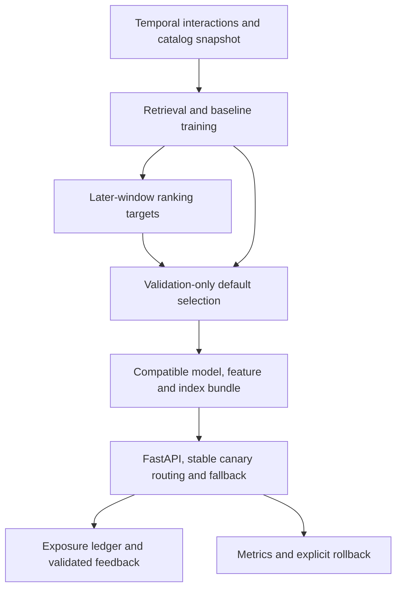

<!-- This is the previous long-form README, kept as the full operator and evidence reference. The top-level README is the short version. -->

# Atlas

**Cold-start recommendations, from offline comparison to versioned serving.**

Atlas compares popularity, collaborative and content baselines with a PyTorch
two-tower retriever, FAISS and optional LightGBM ranking. The API serves compatible
model/index bundles with fallback, canary routing and rollback.

[Try the browser lab](https://jill-vekariya.github.io/atlas-recsys/) · [Recorded results](RESULTS.md) · [Model-selection case study](MODEL_SELECTION_CASE_STUDY.md) · [Runbook](RUNBOOK.md)

## A result worth inspecting

The validation-selected two-tower model reached **0.2340 test NDCG@10**,
compared with **0.2598 for popularity**, in the recorded MovieLens experiment.
The case study follows the selection decision and the cold-start trade-off.
It is a single-seed offline comparison, with validation-only selection.

**Demo scope:** the browser lab runs exported models on a synthetic catalog;
likes and skips stay in the browser. FastAPI, FAISS, persistent feedback and
rollout controls run in the separate Python/Docker application.
[Browser architecture](GITHUB_PAGES.md).

## Further engineering checks

[Multi-seed temporal study](STAGE4_TEMPORAL_STUDY.md) seals validation selections before test evaluation and retains failed seeds and missing cohorts.

## Architecture



Retrieval uses window A; ranking uses frozen A retrieval/histories with later B targets. Validation and test are separate later windows. Controlled cold items lack training interactions but retain catalog snapshot metadata; this does not reconstruct real launch dates. [Evaluation decision](decisions/001-evaluation.md) · [Serving decision](decisions/002-serving.md).

## Quick start: Python API

Requires Git, Python 3.12, uv and dependency-download access. On a fresh checkout:

```bash
git clone https://github.com/Jill-Vekariya/atlas-recsys.git
cd atlas-recsys
uv sync --frozen --extra dev
uv run --no-sync atlas smoke --config configs/smoke.yaml
uv run --no-sync atlas serve
```

Open `http://127.0.0.1:8000/docs`. Smoke prepares synthetic data, trains/evaluates a bundle and activates it; a second activation command is unnecessary. The optional Streamlit lab is `uv run --no-sync streamlit run src/atlas/ui.py --browser.gatherUsageStats=false`, at `http://127.0.0.1:8501`.

Completed bundles/reports are retained. For another experiment, copy the config and select unused `dataset_dir`, `bundle_dir`, `report_dir` and routing `--state` paths. Fresh smoke reports live under `artifacts/reports/synthetic-v1/`; tracked `reports/` measurements are historical. Do not delete old evidence to make a repeated command pass.

For Docker Linux/Compose v2, `docker compose up --build -d` bootstraps the synthetic model in persistent volumes before starting API and lab. Stop with `docker compose down`, preserving volumes. [Deployment guide](DEPLOYMENT.md). A public browser lab is not a hosted Python API; the earlier Render backend attempt was blocked by a payment-information requirement.

## Evidence and verification

| Evidence | Recorded result | Interpretation |
| --- | --- | --- |
| [MovieLens case study](MODEL_SELECTION_CASE_STUDY.md) | Validation-selected model lost to popularity on final test | Retained generalization failure; no invented uplift |
| [Amazon/MovieLens reports](RESULTS.md) | Real-data offline comparisons with explicit cohort sizes and one seed | Ratings are preference proxies; catalog snapshot and cohort assumptions apply |
| [Windows load diagnostic](FINAL_ENGINEERING_VERIFICATION.md) | Synthetic 5 RPS diagnostic met the target; 50 RPS missed it | Host/workload-specific observations, not a latency SLA |
| Stage 4 local review | 24 selected tests passed | Synthetic temporary serving, fallback, feedback, rollout and retention fixtures |

From the installed checkout:

```bash
uv run --no-sync pytest -q
uv run --no-sync ruff check src tests scripts
uv run --no-sync ruff format --check src tests scripts
uv run --no-sync python scripts/model_selection_audit.py --report-dir reports/movielens
python scripts/check_links.py
```

The audit replays recorded model selection without retraining. New canary/load experiments need fresh output paths and the workload limits in [the runbook](RUNBOOK.md); a synthetic injected-error rollback demonstrates routing mechanics, not measured online recommendation quality. The [image manifest](../reports/deployment/image-manifest.json) identifies historical image evidence; a mutable `latest` tag is not a reproducible source identity.

## Serving contract and limits

- Bundle activation checks assets, dimensions, item mappings and feature order before changing routing. Load only trusted operator-built artifacts; checksums detect inconsistency, not authenticity.
- Seen items are excluded. Retrieval exceptions fall back to popularity with an explicit reason. The 150 ms elapsed check happens after retrieval returns and cannot interrupt a native FAISS call.
- Histories are bundle snapshots. Feedback validates exposed items and event identity, rejects load-test traffic and exports separately; it does not immediately retrain/personalize the next request.
- Production mode requires `ATLAS_ENV=production` and a private `ATLAS_API_KEY` of at least 24 characters before startup. Actual request-body bytes are capped at 65,536 before JSON parsing. Local mode/Compose bind to loopback; public deployment needs separate TLS, resource and persistence review.

Single-host state, static catalog/histories, coarse process-local limits and limited offline cohorts remain explicit. No production scale, business A/B gain or fresh public backend availability is established. [Data card](DATA_CARD.md) · [Model card](MODEL_CARD.md).

## Next work and license

Next: rolling as-of histories, reviewed feedback import and a new untouched temporal evaluation period, before infrastructure expansion without a measured need.

Existing [LICENSE](../LICENSE) and [data-rights notice](../NOTICE.md) are preserved.
